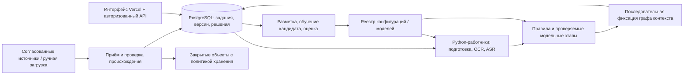

# Архитектурный разбор расширения SafeNet KZ

Статус: **отложено по последнему указанию пользователя «не отходи от ТЗ»**. Код расширения не начат. Сохранённый ниже разбор относится к прежнему обсуждению и не входит в текущий редизайн. Закрытый сбор, архивы персональных данных и новые модели не подключаются. Текущая работа ограничена существующим приложением, удалением отмеченных подписей и отдельной вкладкой графа.

Разбор следует пользовательскому AGENTS.md: сначала архитектура, затем качество кода, тесты и производительность с отдельной остановкой после каждого раздела. Ниже четыре главных решения; для каждого требуется ответ пользователя.

## 1. Постоянное хранилище и надёжная очередь

**Проблема.** Текущие SQLite, память очереди и локальный граф принадлежат одному процессу. Drive сохраняет базу, но не превращает её в безопасную многопроцессную систему. Распараллеливание без смены владения графом нарушит порядок наблюдений и воспроизводимость. Добавление брокера отдельно от записи задания создаёт риск «задание сохранено, сообщение потеряно».

| Вариант | Объём работы | Риск | Влияние | Сопровождение |
|---|---|---|---|---|
| A. Оставить SQLite/Drive | Малый | Сохраняются единый владелец, ограниченная ёмкость и доступность | Достаточно для текущей демонстрации, не решает распределённую обработку | Низкое |
| **B. PostgreSQL, таблица заданий с арендой, отдельные Python-работники, закрытое объектное хранилище** | Большой | Миграция SQL и исторических данных; истечение аренды и повторы | Несколько API/работников, долговременные задания и раздельное хранение артефактов | Среднее: БД, объекты и работники |
| C. PostgreSQL, внешний брокер, независимые микросервисы и графовая БД сразу | Очень большой | Двойная запись, согласованность нескольких систем, сетевые отказы | Больше независимого масштабирования, полезность без нагрузки не доказана | Высокое |

**Рекомендую B.** Сохранить один Python-проект и действующие HTTP-контракты. API атомарно сохраняет команду и задание; работник захватывает ограниченную порцию через блокировку строки и `SKIP LOCKED`, получает срок аренды и номер попытки. Не держать транзакцию во время OCR/ASR. Завершение принимает только актуальный владелец аренды; уникальные ограничения не дают повторно записать результат.

Подготовку можно распараллеливать, но порядок фиксации графа должен быть отдельным, устойчивым порядком в пределах рабочего пространства/контекста. Расчёт использует только предыдущие базовые результаты; исключение собственного голоса и запрет рекурсивного усиления сохраняются. Подтверждение версии и графового события — одна транзакция. Независимые графовые БД рассматривать после измерения SQL-графа, а не включать заранее.

Изображения/аудио хранить в закрытом объектном хранилище с проверкой размера/хеша и серверной авторизацией чтения. В БД — идентификаторы и метаданные; при сбое между записью объекта и транзакцией нужен сбор только подтверждённо осиротевших объектов. Миграция — копирование с проверкой количеств, внешних ключей, UUID, версий и хешей, с сохранением старой БД для отката. Параллельную двойную запись не вводить.

Основание механизма захвата: [PostgreSQL SELECT и блокировки строк](https://www.postgresql.org/docs/current/sql-select.html). Внешний брокер остаётся альтернативой: у [Vercel Queues есть Python SDK](https://vercel.com/docs/queues/python-sdk), но отдельная очередь добавляет согласование записи БД и сообщения. [Vercel Blob SDK](https://vercel.com/docs/vercel-blob/using-blob-sdk) — возможный поставщик объектов; тариф и регион нужно выбрать до создания ресурса.

**Решение для согласования №1:** B; PostgreSQL и долговременные задания, без обязательных микросервисов/графовой БД на первом шаге.

## 2. Сбор, посещение URL и реальные данные

**Проблема.** Сейчас приложение намеренно не посещает URL и принимает синтетику/уже обезличенные данные. Добавление сетевого клиента создаёт SSRF, неконтролируемые перенаправления, расход квот и риск смешения чужих данных. Закрытые группы требуют конкретного источника и явно разрешённой учётной записи; текущих сведений недостаточно для подключения. Персональные связи и архив оригиналов также меняют границу хранения.

| Вариант | Объём работы | Риск | Влияние | Сопровождение |
|---|---|---|---|---|
| A. Только ручной импорт | Малый | Ограниченные сетевые риски; остаётся ручная работа | Не выполняет живой сбор | Низкое |
| **B. Один согласованный источник через официальный API; изолированный загрузчик URL; рабочие пространства и роли** | Большой | Ошибки доступа/редиректов/маскирования остаются, но имеют явные границы | Управляемый живой сбор и проверяемое происхождение | Среднее, зависит от API источника |
| C. Универсальный браузерный сбор, закрытые группы и постоянный архив оригиналов сразу | Очень большой | Неопределённый доступ, утечки, нестабильные интерфейсы и безлимитное хранение | Широкий охват без подтверждённого качества/стоимости | Высокое |

**Рекомендую B.** До подключения назвать платформу, разрешённые каналы/группы, аккаунт и объём. Начать с одного реального коннектора; общий механизм плагинов не заменяет работающий источник. Хранить происхождение, время получения и идентификатор события; повторная доставка не создаёт новый материал. OAuth/ключи — только в серверном хранилище секретов с минимальными правами.

Загрузчик URL получает только HTTP(S), проверяет DNS/IP при каждом перенаправлении, запрещает loopback, частные, link-local и служебные адреса; ограничивает байты, время, число переходов и исходящий трафик. HTML — данные для извлечения, а не исполняемый код или инструкции. Сбор отделён от API аналитика и процессов моделей.

Авторизация проверяет рабочее пространство на каждой карточке, решении, объекте и экспорте; роли просмотра, аналитика и администратора разделены. Идентичности источника связываются по явному идентификатору с пространством имён. Совпадение имени, аватара или суффикса карты не доказывает, что это один человек. Архив исходных персональных данных — отдельный режим с согласованными сроком хранения, перечнем полей и правами; по умолчанию сохраняется обезличенная подготовка. Это решение о продукте и данных, а не подтверждение прав на произвольный источник.

**Решение для согласования №2:** B; указать первый источник. Параметры архива оригиналов согласовать отдельно до включения.

## 3. ASR, эмбеддинги, LLM и обученные классификаторы

**Проблема.** Контракт доказательств пока описывает текст/изображение, но не временной интервал аудио. Вероятностная модель может выдумать цитату или принять входной текст за инструкцию. Синтетический набор не подтверждает качество на реальном русском/казахском; расход внешнего API и передача данных не определены.

| Вариант | Объём работы | Риск | Влияние | Сопровождение |
|---|---|---|---|---|
| A. Сохранить правила и готовые транскрипты | Малый | Известные лексические ограничения | Не добавляет ASR/модельный анализ | Низкое |
| **B. Отдельные версионированные этапы ASR и классификатора; LLM/эмбеддинги сначала в сравнительном режиме** | Большой | Ошибки моделей и стоимость, управляемые ограничениями/оценкой | Новые виды ввода с измеримым вкладом каждого этапа | Среднее/высокое: модели, данные, вычисления |
| C. Единая LLM определяет риск, связи и окончательный текст объяснения | Средний старт, дорогая проверка | Непроверяемые цитаты, нестабильность и зависимость от поставщика | Быстрый широкий прототип, слабая воспроизводимость | Высокое |

**Рекомендую B.** Начать ASR с загружаемого аудио с ограничением длительности/размера, а не непрерывного стрима. Сохранить язык/версию, сегменты времени, явный отказ на повреждённом/пустом входе и связь с обезличенным транскриптом. Расширить контракты и интерфейс доказательством «источник + интервал времени»; правила продолжают объяснять именно сохранённый транскрипт. Выбор модели, локального/GPU или внешнего API зависит от согласованных русского/казахского качества, среды и бюджета.

Обученный классификатор сначала сравнить с текущими правилами на изолированных данных. Эмбеддинги дают кандидатов связей с отдельной причиной, не тождество людей. LLM возвращает строгую структуру; цитаты и координаты проверяются по источнику, неподтверждённые утверждения отклоняются. Внешней модели передаются только согласованные поля после маскирования. Промпт, модель, параметры, данные и конфигурация входят в версию запуска; старые результаты не пересчитываются автоматически.

Метрики считать по языкам и трекам, с отдельным учётом ошибок OCR/ASR. Финальный test не использовать для выбора модели/весов: нужны обучение и валидация, а пороги приёмки precision/FPR и стоимости ещё предстоит согласовать. Нельзя обещать улучшение до измерения.

**Решение для согласования №3:** B; модели вводить проверяемыми этапами, сначала без автоматического влияния нового модельного этапа на действующие оценки.

## 4. Автопереобучение, настройки, плагины и реестр моделей

**Проблема.** Действие аналитика сейчас относится к конкретной версии результата и не является готовой обучающей меткой. Автообучение на каждом клике усиливает ошибки и утечку между выборками. Редактор весов и произвольные плагины открывают новые права на поведение и код сервера.

| Вариант | Объём работы | Риск | Влияние | Сопровождение |
|---|---|---|---|---|
| A. Только ручной TOML, без моделей/редактора | Малый | Изменения требуют разработчика | Соответствует прототипу, не выполняет расширение | Низкое |
| **B. Версии конфигурации и моделей в БД, редактор с черновиком/проверкой/активацией, автоматическое обучение кандидата** | Большой | Нужны права, журнал, воспроизводимость и откат | Управляемые изменения с сохранением истории | Среднее |
| C. Автоматически учиться/активироваться по всем решениям; устанавливать произвольные плагины из UI | Очень большой | Отравление данных, ухудшение качества, выполнение чужого кода | Максимальная автоматизация с неприемлемой неопределённостью | Очень высокое |

**Рекомендую B.** Реестр — конкретные версии артефакта с хешем, происхождением, лицензией, настройками и отчётом оценки, а не отдельный универсальный сервис. Решения проходят процедуру разметки и исключают дубликаты/переанализы одного источника; споры сохраняются. Расписание может обучать кандидата, но активация требует проверки качества и одобрения ответственного; откат возвращает ссылку на предыдущую неизменяемую версию. Пороговые критерии активации и права согласуются до включения автоматики.

Редактор меняет черновик, проверяемый существующей конфигурационной моделью; опубликованная версия неизменяема, действие пишется в журнал. Новое задание закрепляет версию при создании. Плагины сначала — явно подключаемые доверенные реализации реально выбранного источника/модели, а не установка кода из браузера. Универсальная рамка и отдельный реестр-сервис добавляются только при появлении нескольких независимых реализаций и операционной необходимости.

**Решение для согласования №4:** B; автоматическое обучение кандидатов, контролируемая активация, версионирование и ограниченные доверенные расширения.

## Предлагаемые границы и зависимости

Это предложение по техническим зависимостям, а не назначение бизнес-приоритетов. Перенос данных/прав необходим до приёма реальных закрытых источников; контракты аудио необходимы до ASR-доказательств; процедура разметки и оценки необходима до автопереобучения. Стоимость поставщиков, регион, сроки хранения, первый источник и метрики остаются открытыми решениями.

После согласования архитектуры следующий шаг — **Code Quality Review** расширения: границы `service.py`/SQL/графа, повторное использование контрактов, миграции вызывающего кода, ошибки и версионирование. Затем отдельно Test Review и Performance Review. Код новых возможностей начинается после завершения этих согласований, как требует пользовательский порядок.
