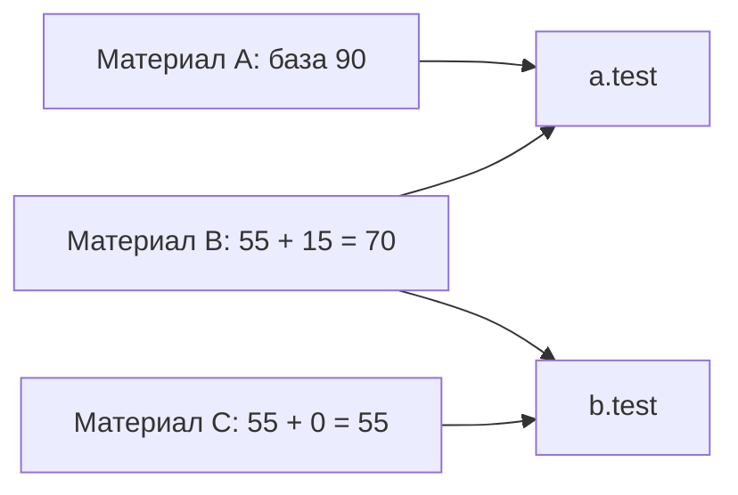

# Фаза 5 — граф связей и ограниченное влияние

Дата: 25 октября 2026 года, Asia/Qyzylorda. Фаза 5 завершена. Переход к фазе 6 ожидает одобрения пользователя.

## Что реализовано

- Индексированный двудольный граф: материалы ↔ аккаунты, домены, тестовые карты, промокоды и повторяющиеся тексты. Общая сущность не разворачивается в клику попарных связей.
- Связи по предоставленным цепочкам редиректов без сетевых запросов. Хвосты маскированных карт, телефоны и суммы не становятся идентификаторами.
- Независимые индексы train/validation/test/demo; источниками влияния служат только ранее обработанные высокие **базовые** оценки соответствующего трека.
- Ограниченный графовый вклад с отдельным объяснением, исходным материалом, статистикой общего узла и снимком контекста. Повышенная через граф оценка не становится новым источником усиления.
- Снимки префиксов, кешированные размеры и компоненты связности; ограниченная окрестность с признаком сокращения. Лимиты отображения не меняют скоринг.
- Интеграция в общий движок и автономную команду. Исторические результаты фазы 4 сохранены; новые зависимости не добавлены.

Код: `src/safenet/graph.py`; затронутые общие контракты и настройки — `contracts.py` и `config.py`; вызовы — `pipeline.py` и `score.py`. Формулы и правила шаблонов подробно описаны в [METHODOLOGY.md](../METHODOLOGY.md).

## Результат на обучающих данных

Успешно обработаны **720 материалов**: 240 текстов, 240 готовых транскриптов и 240 скриншотов. Неполных результатов — **0**, ошибок — **0**. Повторный проверочный прогон из кэша выполнен с запрещённым созданием OCR-процессов.

| Узлы графа | Количество |
|---|---:|
| Материалы | 720 |
| Синтетические аккаунты | 60 |
| Домены | 108 |
| Шаблоны текста | 510 |
| Синтетические карты | 8 |
| Промокоды | 6 |
| Всего | **1 412** |

Получено **2 645 рёбер**, **30 компонент связности**. Наибольшая компонента содержит **24 материала**. Это компоненты наблюдаемых связей, а не доказательство единого владельца или общей схемы. Метки кампаний при построении графа не использовались.

Происхождение рёбер: метаданные аккаунта — 720, извлечённый текст — 997, предоставленные редиректы — 208, текстовый шаблон — 720.

Графовый вклад рассчитан для **220 материалов**, всего **241 вклад по трекам**, в диапазоне **1,875–15 баллов**. После ограничения итогов диапазоном 0–100 балл действительно увеличился у **150 материалов** в **170 результатах по трекам**; максимальный балл очереди увеличился у **148 материалов**. Остальные положительные вклады частично или полностью поглощены верхним ограничением — это отражено в `cap_adjustment`.

У **двух** материалов инвестиционного трека уровень изменился со среднего на высокий: базовый балл **55**, графовый вклад **15**, итог **70**.

| Трек | Низкий | Средний | Высокий |
|---|---:|---:|---:|
| Признаки платных розыгрышей | 635 | 17 | 68 |
| Признаки продвижения казино | 587 | 24 | 109 |
| Инвестиционные и реферальные признаки | 607 | 58 | 55 |

Все базовые признаки, цитаты и оценки совпали с сохранёнными результатами фазы 4. Граф использовал только предшествующий контекст в порядке манифеста. Это проверка работы механизма, **не оценка точности и не доказательство её улучшения**. Validation/test не запускались для скоринга или настройки; их файлы читались только побайтово для проверки контрольных сумм.

## Как ограничено влияние

При базовом балле ниже 40 вклад графа равен нулю. Иначе выбирается наиболее сильный общий узел:

```text
вклад = 15 × (число предшествующих высоких базовых результатов
              / число всех предшествующих материалов с этим узлом)
```

Вклады разных узлов не складываются. Если из четырёх предшествующих материалов на общем домене только один имеет высокий базовый балл нужного трека, вклад равен **3,75**, а не 15. Число 15 и пороги остаются предварительными настройками, не откалиброванными на validation.

Независимый пример из [phase5_examples.json](phase5_examples.json) показывает отсутствие каскадного усиления:



A имеет высокий базовый балл и усиливает B через `a.test`. Базовый балл B остаётся 55, поэтому C не получает усиления через `b.test`, хотя все три материала находятся в одной компоненте. Цитаты, вклад и снимок для каждого материала сохранены в примере.

## Снимки, изоляция и ограничения

Материал с порядковым номером `n` получает оценку по снимку `n−1`. Только после этого его связи и базовые оценки добавляются в индекс. Порядок отражает доступность при обработке; дата публикации не используется для подглядывания вперёд. Историческая окрестность по умолчанию включает сам материал и предшествующий контекст, но не позднейшие материалы.

Один индекс закреплён за одной выборкой и конфигурацией. Несовпадающая область, повторный UUID материала, попытка использовать уже усиленный результат или превышение ёмкости отклоняются без частичного добавления в граф. Выборку задаёт доверенный вызывающий код; автоматической проверки принадлежности по имени каталога нет.

Текущие ограничения обработки: **100 000 узлов**, **200 000 рёбер**, а также общий предел числа записей. При превышении возвращается неполный результат без итоговых баллов. Отображение ограничено **100 узлами / 200 рёбрами**, допускает меньшие границы и явно сообщает `truncated` и общее число рёбер доступной двухшаговой окрестности. Статистика и графовый вклад рассчитываются по полному разрешённому контексту.

Примеры окрестностей двух материалов с изменившимся уровнем риска: [phase5_neighborhoods.json](phase5_neighborhoods.json). Полный граф и снимки: `data/graphed-train-v1/graph.json`.

## Проверки

Полный набор: **247 тестов, 0 ошибок, 0 падений, 0 пропусков**. Ruff lint и форматирование проходят. К существующим проверкам добавлены 28 случаев, включая:

- Все типы связей, совпадение UUID аккаунта в тексте и метаданных, документированный шаблон текста.
- Раздельные выборки и конфигурации, отсутствие будущих материалов в историческом просмотре, позднее поступление старого поста.
- Отсутствие рекурсивного и транзитивного усиления, раздельное влияние по трекам, защита низких базовых оценок.
- Ограничение вклада, ослабление общих узлов, отсутствие суммирования нескольких связей, явное насыщение балла.
- Разные карты с одинаковым маскированным хвостом, отсутствие идентификации по суммам, сохранение безопасных значений в экспорте.
- Пределы узлов/рёбер/записей без частичной мутации; сокращение просмотра без изменения расчёта.
- Общий домен у **1 000 материалов**: **1 001 узел и 1 000 рёбер**, без попарной клики; просмотр остаётся ограниченным.
- Строгая сериализация результатов, повторяемость снимков, интеграция CLI и сравнение с базовым режимом на ручном примере.

Аудит обучающего прогона подтвердил **2 160 результатов по трекам**, **1 809 признаков**, **2 128 ссылок на текст/OCR**, все **241 графовое объяснение** и каждый снимок префикса. Полный экспорт совпал с повторным построением. Проверены **406** контрольных сумм замороженного датасета; данные не изменялись.

Машинные артефакты: [phase5_graph_summary.json](phase5_graph_summary.json), [phase5_tests.xml](phase5_tests.xml). Отчёт содержит SHA-256 исходных файлов. Отпечаток текущей конфигурации: `8caa10198e5581bf994caa9d3cd4ab94b3447a89d71bc1e789b45f825cd0a24c`; версия графа — `1`. Отпечаток изменился из-за добавленных настроек графа, а подготовленные данные удалось повторно использовать.

## Как запустить

Из корня проекта после подготовки данных:

```powershell
.venv\Scripts\python.exe -m safenet.score --input data/prepared-train-v1 --output data/graphed-train-v1 --graph-scope train
```

Каталог уже существует в переданном результате. Для повторного запуска укажите новый `--output`: существующие результаты не перезаписываются. Выход содержит `outcomes.jsonl`, `queue.jsonl`, `summary.json` и `graph.json`. Без `--graph-scope` сохраняется базовый режим с нулевым влиянием графа.

## Что дальше и что не проверено

Фаза 6 — API обработки, восстановление после перезапуска, транзакционное сохранение результатов и действий аналитика — **не начата**. Сейчас граф строится в памяти для одного автономного прогона; данные экспортируются, а восстановление индекса и переанализ версий будут согласованы с хранилищем в фазе 6. Графический интерфейс остаётся фазой 7.

Точность, FPR и абляции на отложенной выборке, калибровка коэффициентов и проверка на реальных данных не выполнялись. Совпавший домен или шаблон не доказывает общность владельца; локальные эвристики и OCR могут ошибаться. Масштабный бенчмарк остаётся фазой 9. Docker не проверен: он отсутствует на машине.

Система показывает признаки для ручной проверки. Итоговое решение принимает аналитик.
